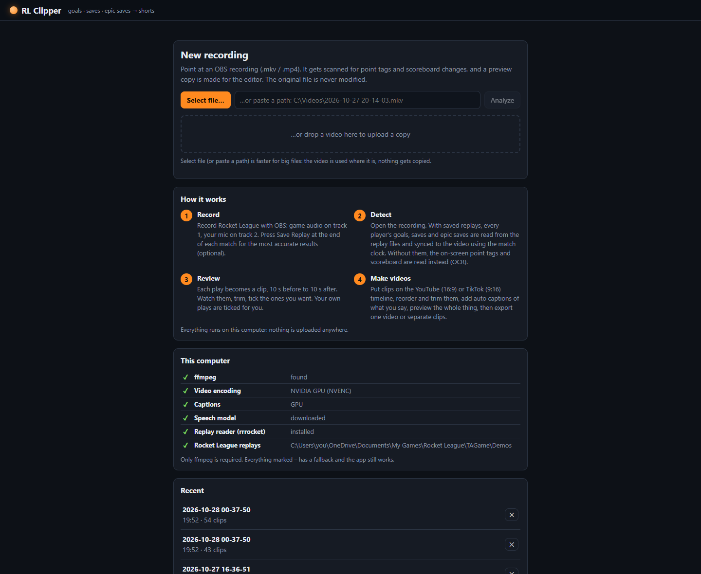
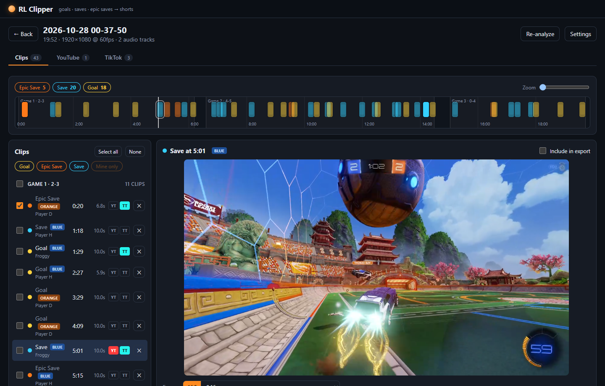
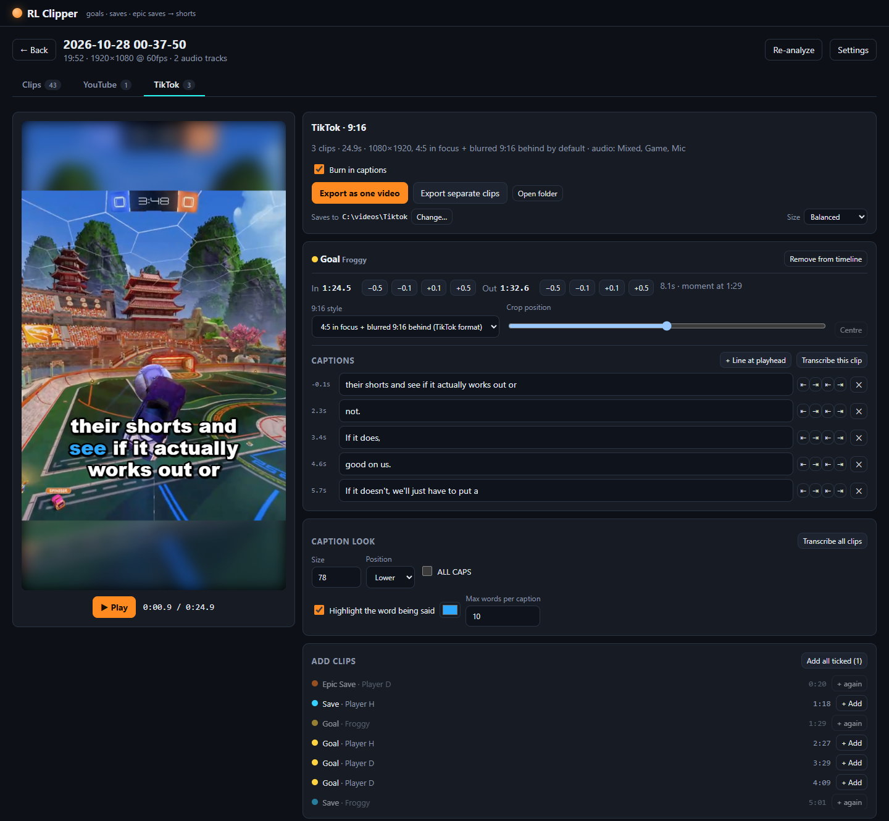
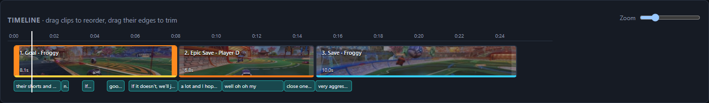
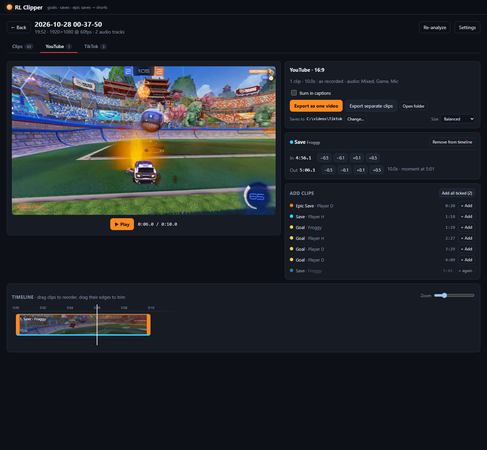

# RL Clipper

[](https://github.com/Youssof-Kandil/rl-clipper/actions/workflows/ci.yml)
[](LICENSE)
[](#requirements)

**Turn long Rocket League recordings into YouTube clips and TikToks, automatically.**

Created by **[Youssof Kandil (@Youssof-Kandil)](https://github.com/Youssof-Kandil)**.

RL Clipper finds every **goal, save and epic save** in an OBS recording. It reads the exact moments from Rocket League's own replay files, or from the on-screen point tags when there's no replay. You get a clip for every play: review and trim them, arrange them on a YouTube (16:9) or TikTok (9:16) timeline, add auto-captions of what you said, and export one video or separate clips.

Everything runs on your own computer. Nothing is uploaded anywhere.



---

## Contents

- [Features](#features)
- [Screenshots](#screenshots)
- [Requirements](#requirements)
- [Install and run](#install-and-run)
- [Recording setup](#recording-setup)
- [Using RL Clipper](#using-rl-clipper)
- [How it works](#how-it-works)
- [Technology](#technology)
- [Settings reference](#settings-reference)
- [Troubleshooting](#troubleshooting)
- [Development](#development)
- [Project layout](#project-layout)
- [Contributing and reporting bugs](#contributing-and-reporting-bugs)
- [Credits and license](#credits-and-license)

---

## Features

- **Automatic play detection**
  - With Rocket League replays: every player's goals, saves and epic saves at their exact moment, synced to your video using the match clock (overtime included).
  - Without replays: OCR of the "SAVE +50", "EPIC SAVE +75" and "GOAL +100" tags and of the scoreboard.
- **Clip review**
  - A timeline of the whole recording, split into games, plus a clip list grouped by game.
  - A trim editor with frame stepping and keyboard shortcuts.
  - Your own plays are ticked automatically.
- **YouTube and TikTok timelines**
  - A CapCut-style editor: drag clips to reorder them, and drag their edges to trim.
  - A live preview of the finished video in its real format.
  - Export **one compiled video** or **separate clips**.
- **9:16 for TikTok, Shorts and Reels**, in four styles:
  - **4:5 in focus + blurred 9:16 behind** (the default)
  - **Crop + oval focus blur**
  - **Plain crop**
  - **Fit + blurred fill**

  Each clip has its own crop position.
- **Auto-captions** of what you say (Whisper, running locally):
  - Whole sentences, with the word you're saying highlighted as you say it.
  - Editable line by line.
  - Burned into the video.
- **Keeps your OBS audio separate.** Every export has three tracks: **Mixed** (game + mic, the default), **Game** and **Mic**.
- **Works on any computer.**
  - Uses an NVIDIA GPU for encoding and captions when there is one, and falls back to the CPU otherwise.
  - Windows, macOS and Linux.

## Screenshots

| Review clips | TikTok editor |
|---|---|
|  |  |

**Timeline:** drag to reorder and trim. The caption track sits under the clips.



**YouTube timeline (16:9)**



## Requirements

| | Required? | Install |
|---|---|---|
| **[ffmpeg](https://ffmpeg.org) 6+** (with ffprobe) | **Yes** | Windows: `winget install Gyan.FFmpeg` · macOS: `brew install ffmpeg` · Linux: `sudo apt install ffmpeg` |
| **[uv](https://docs.astral.sh/uv/)** (downloads Python 3.12 for you) | **Yes** | Windows: `winget install astral-sh.uv` · macOS/Linux: `curl -LsSf https://astral.sh/uv/install.sh \| sh` |
| **[Node.js](https://nodejs.org) 20+** | **Yes** (builds the web UI) | nodejs.org, `winget install OpenJS.NodeJS.LTS`, or `brew install node` |
| NVIDIA GPU | No | Faster exports (NVENC) and faster captions. Without one, the CPU is used. |
| Rocket League replays | No | Most accurate detection, including everyone's plays. Without them, on-screen detection is used. |

**Disk:** the Python packages take about 1 GB. Each project stores a 720p preview copy of its video. The optional caption model is about 480 MB, and the optional GPU caption libraries about 1 GB.

**Platforms:**
- **Windows 10/11:** fully supported.
- **macOS (Intel and Apple Silicon) and Linux:** work, running on the CPU. On Linux, Rocket League runs through Steam Proton, and its replay folder there is found automatically.

## Install and run

1. **Get the code:** clone this repository, or download it as a ZIP and extract it.
2. **Start it.** On first run, the launcher installs everything it needs, builds the UI and opens your browser at **http://127.0.0.1:8765**.

**Windows** (PowerShell):

```powershell
.\run.ps1
```

If PowerShell refuses to run scripts, run this once: `Set-ExecutionPolicy -Scope CurrentUser RemoteSigned`.

**macOS / Linux:**

```bash
bash run.sh
```

What the launcher does:

1. Checks for ffmpeg, uv and npm, and tells you how to install anything that's missing.
2. Runs `uv sync`, which creates `backend/.venv` with the Python dependencies. With an NVIDIA card (`nvidia-smi` found), it also adds the GPU caption libraries.
3. Runs `npm install` (first time only) and `npm run build` for the web UI.
4. Starts the server at `127.0.0.1:8765` (this computer only) and opens your browser.

To use another port: `.\run.ps1 -Port 9000` or `PORT=9000 bash run.sh`.

<details>
<summary>Manual start (any OS)</summary>

```bash
cd backend
uv sync                      # add "--group gpu" for GPU captions (NVIDIA, Windows/Linux)
cd ../frontend
npm install && npm run build
cd ../backend
uv run uvicorn app.main:app --host 127.0.0.1 --port 8765
```

</details>

The home page has a **This computer** panel. It shows what was found (ffmpeg, GPU encoding, GPU captions, rrrocket, the replay folder) and the fallback used for anything missing.

## Recording setup

### OBS: two audio tracks

1. Open *Settings → Output*, set **Output Mode** to **Advanced**, and open the **Recording** tab.
2. Tick **audio tracks 1 and 2**.
3. Under *Edit → Advanced Audio Properties*, put **Desktop Audio on track 1** and your **Mic on track 2**.
4. **Recording format:** MKV is the safest (a crash doesn't corrupt it). MP4 works too.
5. **Recording path:** keep OBS's default file name (`2026-10-27 20-14-03.mkv`). The app reads the recording's start time from it to match replays.

If your tracks are the other way around, swap them in RL Clipper's **Settings → Audio tracks**.

### Rocket League: save your replays (recommended)

Press **Save Replay** on the end-of-match screen of every match you record. Replays are saved automatically to:

- **Windows:** `Documents\My Games\Rocket League\TAGame\Demos` (also under OneDrive)
- **Linux (Proton):** `~/.local/share/Steam/steamapps/compatdata/252950/pfx/drive_c/users/steamuser/Documents/My Games/Rocket League/TAGame/Demos`

A different folder can be set in Settings. Matches without a saved replay still get on-screen detection.

## Using RL Clipper

1. **Open a recording.** Click **Select file…**, paste a path, or drop a file onto the page. Select and paste use the file where it is; dropping uploads a copy.
2. **Wait for the scan.** Progress shows at the top. A 20-minute recording with replays takes about 3 minutes. A 720p preview copy is built at the same time.
3. **Review (Clips tab).**
   - Every play becomes a clip, from 10 s before to 10 s after the moment.
   - Click a clip to watch it, and drag the orange handles to trim.
   - Tick the clips you want; your own plays start ticked.
   - "Mine only" hides other players' plays.
   - Shortcuts: `Space` play/pause, `←`/`→` frame step (with `Shift`: 1 s), `I`/`O` set in/out.
4. **Make a video (YouTube or TikTok tab).**
   - **Add clips:** use the **YT** / **TT** buttons on clip rows, or **Add clips** in the tab. The first time you open an empty timeline, it fills with your ticked clips.
   - **Arrange:** drag clips on the timeline to reorder them, and drag their edges to trim. Each timeline keeps its own trims.
   - **TikTok only:** pick the 9:16 style and crop position per clip in the clip panel.
   - **Preview:** press **Play** to watch the whole video, cut to cut.
5. **Captions (TikTok).**
   - The first time, click **Download speech model** (about 480 MB).
   - Then use **Transcribe all clips**, or **Transcribe this clip** for a single clip.
   - Edit any line's text and timing in the clip panel.
   - Look (size, position, ALL CAPS, highlight colour) is under **Caption look**.
6. **Export:** **Export as one video** or **Export separate clips**.
   - The first export asks where files should go.
   - **Size:** Balanced (default), Best, or Small (HEVC).

### Output files

| | Video | Audio tracks |
|---|---|---|
| YouTube | as recorded (e.g. 1920×1080), H.264 | Mixed, Game, Mic |
| TikTok | 1080×1920, H.264 (HEVC with "Small"), captions burned in | Mixed, Game, Mic |

Names look like `<recording>_tiktok_compiled.mp4` or `<recording>_youtube_02_save_05-01.mp4`.

## How it works

### 1. Finding the plays

**With Rocket League replays (preferred)**

1. **Finding the right replays:** a replay belongs to the recording if its match started while the recording was running. The match start comes from the replay header, the recording start from the OBS file name.
2. **Reading the plays:** [rrrocket](https://github.com/nickbabcock/rrrocket) decodes each replay's network stream. RL Clipper downloads the right build for your system into `tools/` on first use.
   - A `ReplicatedStatEvent` says *what* happened (Goal / Save / EpicSave) and when.
   - The player's `MatchGoals` / `MatchSaves` counter going up says *who*.
3. **Syncing to the video:** a replay is not a continuous copy of real time. It skips part of every goal replay, so a single offset drifts by several seconds over a match. Instead:
   - The replay's clock ticks (`SecondsRemaining`) are split into **stretches** from kickoff to goal; overtime, which counts up, is a stretch of its own.
   - The video's clock is OCR'd 1.1 times per second. Because that rate isn't a whole number, readings slide across each second.
   - Each stretch gets the offset most readings agree on, accurate to a fraction of a second.
   - Each stretch must land just after the previous one, so it can't lock onto the identical "0:32 → 0:00" ending of a neighbouring match.
4. **Fallbacks:** if the clock can't be read, the match is lined up on goals (the video's scoreboard change), then on the match start time.

**Without replays (on-screen detection)**

1. ffmpeg decodes the video at 2 frames per second, downscaled to 1280 px.
2. **Point tags:** the area under the scoreboard is checked for bright text. When there is some, OCR ([RapidOCR](https://github.com/RapidAI/RapidOCR)) reads it and fuzzy-matches it to SAVE / EPIC SAVE / GOAL. The points value (+50 / +75 / +100) confirms the type. Tags appear about 1 s after the play, so events are moved 1 s earlier.
3. **Scoreboard:** the score boxes are read once a second. A +1 that holds for two reads is a goal; this also catches teammates' and opponents' goals. Misreads such as "3" → "13" are ignored.
4. **Sides:** your team is always shown on the left, and blue vs orange is told apart by the box colour.

Parts of a recording without a matching replay get on-screen detection; the rest come from replays.

### 2. Framing

- **16:9 exports** keep the recording as it is.
- **9:16 exports** are built in one ffmpeg filter graph. For the default style:
  - a 9:16 crop is blurred (at quarter resolution, which is much faster) and darkened as the background;
  - a full-height 4:5 crop (scoreboard included) is laid over it at 1080×1350, sharp.
- **The preview is a stand-in:** the editor draws the same thing on a `<canvas>` from the preview video, so it matches the export without rendering anything.
- **Smooth cuts:** two hidden video players take turns, one waiting on the next clip's first frame, so the timeline preview plays through cuts without stalling.

### 3. Captions

1. **Transcription:** the mic track of each timeline clip is extracted (16 kHz mono) and transcribed by [faster-whisper](https://github.com/SYSTRAN/faster-whisper) (`small.en` by default) with word timestamps and voice-activity filtering.
2. **Device:** the GPU (CUDA) is tried first, with the CPU as the fallback. Both use int8 weights, so the text is the same either way.
3. **Captions:** words are grouped into sentences of up to 8 words, breaking at sentence ends and pauses. Captions are stored in recording time, so a fix shows up on every timeline that uses that moment.
4. **Export:** an ASS subtitle file is generated per clip, with one event per word, which is how the highlight moves. libass burns it in.

### 4. Exporting

- **Per clip:** each clip is cut from the original recording (not the preview), framed, captioned and encoded.
  - Encoder: NVENC when it works, otherwise libx264 (libx265 for "Small").
  - Audio: the Mixed track is an `amix` of the game and mic tracks.
- **Compiled videos:** the clips are rendered with identical settings, then joined with ffmpeg's concat demuxer without re-encoding.

## Technology

| Part | What |
|---|---|
| Backend | Python 3.12, [FastAPI](https://fastapi.tiangolo.com), [uvicorn](https://www.uvicorn.org); a small in-process job runner for long tasks |
| Video | [ffmpeg](https://ffmpeg.org) / ffprobe: decoding, filters (crop, blur, overlay, subtitles), NVENC / x264 / x265, concat |
| Detection | [RapidOCR](https://github.com/RapidAI/RapidOCR) (ONNX Runtime), [OpenCV](https://opencv.org), NumPy |
| Replays | [rrrocket](https://github.com/nickbabcock/rrrocket) (Rocket League replay parser, downloaded on first use) |
| Captions | [faster-whisper](https://github.com/SYSTRAN/faster-whisper) / CTranslate2; optional NVIDIA cuBLAS + cuDNN for GPU; libass (in ffmpeg) to burn in |
| Frontend | [React 18](https://react.dev), TypeScript, [Vite](https://vitejs.dev); canvas preview; no UI framework |
| Storage | Plain JSON per project in `data/projects/<id>/`, settings in `data/settings.json` |
| Tooling | [uv](https://docs.astral.sh/uv/) for Python, npm for the UI, pytest, GitHub Actions (Windows, macOS, Linux) |

## Settings reference

Open **Settings** on a project. Everything is saved in `data/settings.json`.

| Group | Setting | Default | What it does |
|---|---|---|---|
| Detection | Regions | tuned for default HUD | Where the point tags and scoreboard are, with a live preview. Adjust for a different HUD scale. |
| Detection | Frames per second | 2 | On-screen scan rate (higher is slower but catches shorter tags). |
| Clips | Max seconds before / after | 10 / 10 | Clip length around the moment, and how far you can trim out. |
| Replays | Use saved replays | on | Replay-first detection. |
| Replays | In-game name | from replays | Whose plays are "mine". |
| Replays | Replay folder | auto | Where the `.replay` files are. |
| Audio | Game / mic track | 1 / 2 | Which OBS tracks hold game audio and mic. |
| Export | Export folder | asked on first export | Where exports are saved. |
| Export | Frame / 9:16 style | 16:9 / 4:5 focus | Defaults for the Clips tab (the TikTok tab is always 9:16). |
| Export | Blur, sharp area, zoom | 30 / 0.55 / 1.0 | The look of the 9:16 styles. |
| Export | Export size | Balanced | Best ≈ 4 MB/s · Balanced ≈ 3 MB/s · Small (HEVC) ≈ 2 MB/s of 9:16 video. |
| Export | Video encoder | Auto | Auto (NVENC if it works) / NVENC / CPU. |
| Captions | Speech model | small.en | base.en (fast) · small.en · medium.en (most accurate, best on GPU). |
| Captions | Size, position, ALL CAPS | 78 / lower / off | Caption look. |
| Captions | Highlight + colour | on, #2EA8FF | Colour the word being said. |
| Captions | Max words per caption | 8 | Used by the next transcription. |

## Troubleshooting

| Problem | Fix |
|---|---|
| "ffmpeg not found" | Install ffmpeg (see Requirements) and restart. On Windows, open a **new** terminal after `winget install`. |
| No replays found | Check that **Save Replay** was pressed for those matches. The recording must keep OBS's date-time file name, and Settings → Replay folder must point to `TAGame\Demos`. The **Matches** panel on a project shows what was found. |
| Clips a few seconds off | Re-analyze the recording. If a match was synced from "goals" or "start time" instead of "the match clock" (shown in the Matches panel), the clock couldn't be read: check the scoreboard region in Settings. |
| No plays found without replays | Your HUD may differ: adjust the detection regions in Settings with the live preview, then re-analyze. |
| Captions say "CPU" | Normal without an NVIDIA GPU. With one, run `uv sync --group gpu` in `backend/` (the launchers do this automatically) and restart. |
| "No file dialog available" | Happens on headless or remote machines. Paste the file path instead. |
| Export is large | Pick **Small** in the Size menu next to the export buttons. |
| Port 8765 in use | `.\run.ps1 -Port 9000` / `PORT=9000 bash run.sh`. |
| Something else | Run the launcher in a terminal and check its output, then open an issue with it. |

## Development

```bash
# Backend with auto-reload + Vite dev server with hot reload (http://localhost:5173)
.\run.ps1 -Dev            # Windows
bash run.sh --dev         # macOS / Linux

# Tests (about 100; the ffmpeg-based ones are skipped if ffmpeg is missing)
cd backend
uv run pytest

# A synthetic 60 s test recording with point tags and a scoreboard
uv run python tests/make_sample.py ../data/sample.mkv

# Command-line detection (prints events; --debug saves every OCR crop)
uv run python -m app.detect path/to/recording.mkv --debug ../data/debug
```

CI (`.github/workflows/ci.yml`) runs the backend tests on Windows, macOS and Linux and builds the UI.

## Contributing and reporting bugs

- **Found a problem?** [Open a bug report](https://github.com/Youssof-Kandil/rl-clipper/issues/new/choose). The form asks for what's needed to fix it, including the home page's "This computer" panel.
- **Have an idea?** [Open a feature request](https://github.com/Youssof-Kandil/rl-clipper/issues/new/choose).
- **Want to help?** Read [CONTRIBUTING.md](CONTRIBUTING.md) for setup, rules and the pull request checklist, then send a pull request.
- **Security issue?** Report it privately; see [SECURITY.md](SECURITY.md).

Everyone taking part follows the [Code of Conduct](CODE_OF_CONDUCT.md).

## Project layout

```
run.ps1 / run.sh              launchers (install deps, build the UI, start the server)
LICENSE, NOTICE               Apache-2.0 + attribution (keep NOTICE in any redistribution)
CONTRIBUTING.md, SECURITY.md  how to contribute and report problems; CODE_OF_CONDUCT.md
.github/                      CI, issue forms, pull request template
backend/
  app/main.py                 FastAPI app: REST API, background jobs, serves the built UI
  app/config.py               paths and settings (data/settings.json)
  app/store.py, jobs.py       project storage (data/projects/<id>/) and the job runner
  app/media.py                ffprobe, preview proxy, export (framing, captions, encoders, concat)
  app/replays.py              find, download (rrrocket) and read Rocket League replays
  app/detect/                 frame sampler, OCR, tag classifier, scoreboard + clock reader, replay sync
  app/sequences.py            YouTube / TikTok timelines
  app/captions.py             transcription, caption lines, ASS subtitles
  app/picker.py               native file / folder dialogs
  tests/                      pytest suite + fixtures
frontend/src/
  components/                 Home, project tabs, clip list, editor, timelines, settings
  render.ts                   canvas preview mirroring the export
docs/screenshots/             README images
data/                         your projects, settings and models (created on first run, not in git)
tools/                        rrrocket download (not in git)
```

## Credits and license

**RL Clipper is created and maintained by [Youssof Kandil (@Youssof-Kandil)](https://github.com/Youssof-Kandil).**

It's open source under the [Apache License 2.0](LICENSE). You may use, modify and redistribute it, including commercially, as long as you:

- **keep the attribution:** include the [NOTICE](NOTICE) file, crediting Youssof Kandil, with any copy or derived work you distribute;
- **mark what you changed:** modified files must say that you changed them;
- **keep the license:** include a copy of the Apache 2.0 license.

If you build on RL Clipper, a link back to this repository is appreciated. [CITATION.cff](CITATION.cff) has the citation details.

It builds on:

- [ffmpeg](https://ffmpeg.org) (LGPL/GPL, installed separately)
- [rrrocket](https://github.com/nickbabcock/rrrocket) (MIT)
- [faster-whisper](https://github.com/SYSTRAN/faster-whisper) (MIT)
- [OpenAI Whisper](https://github.com/openai/whisper) models (MIT)
- [RapidOCR](https://github.com/RapidAI/RapidOCR) (Apache-2.0)
- [FastAPI](https://fastapi.tiangolo.com) (MIT)
- [React](https://react.dev) (MIT)

Rocket League is a trademark of Psyonix. This project is not affiliated with or endorsed by Psyonix or Epic Games.
