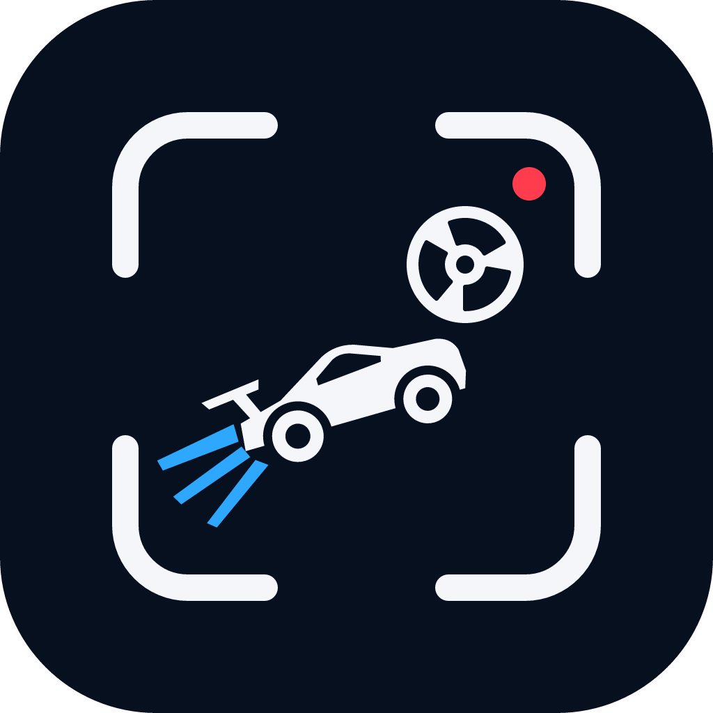

# Terms of Service

*Last updated: 29 October 2026*

RL Clipper is free, open-source software by Youssof Kandil ([@Youssof-Kandil](https://github.com/Youssof-Kandil)), provided under the [Apache License 2.0](LICENSE). By using it you agree to these terms.

1. **Your content, your responsibility.** You may only process and post videos you have the rights to. When you post to YouTube or TikTok through RL Clipper, you are posting as yourself. You must follow the [YouTube Terms of Service](https://www.youtube.com/t/terms), [YouTube's Community Guidelines](https://www.youtube.com/howyoutubeworks/policies/community-guidelines/), [TikTok's Terms of Service](https://www.tiktok.com/legal/terms-of-service) and [TikTok's Community Guidelines](https://www.tiktok.com/community-guidelines).
2. **Your own developer apps.** To post, you connect RL Clipper to your own Google and TikTok developer apps. You are responsible for those apps, their keys and their use under Google's and TikTok's developer terms.
3. **Nothing posts without you.** RL Clipper only uploads a video when you choose it and press Post (or schedule it on YouTube).
4. **No warranty.** RL Clipper is provided "as is", without warranties of any kind, as set out in the Apache License 2.0. The authors are not liable for any damages arising from its use, including lost or wrongly posted content.
5. **Trademarks.** Rocket League is a trademark of Psyonix. YouTube is a trademark of Google LLC. TikTok is a trademark of ByteDance. RL Clipper is not affiliated with or endorsed by any of them.
6. **Privacy.** See the [Privacy Policy](PRIVACY.md).
7. **Changes.** These terms may be updated in the [project repository](https://github.com/Youssof-Kandil/rl-clipper). Continuing to use RL Clipper after a change means you accept it.

Questions: [open an issue](https://github.com/Youssof-Kandil/rl-clipper/issues).
